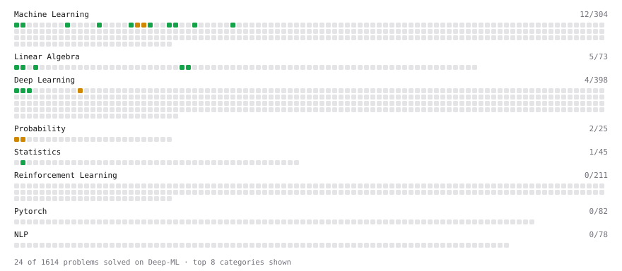

# Deep-ML

My machine learning practice from [Deep-ML](https://www.deep-ml.com). Every solution here was written by hand.

**30** solved · 30 problems

[**Browse the interactive portfolio**](https://Davidkaaa33.github.io/deep-ml/) to replay this filling in over time.

## How I practice

I first solve each problem independently, usually starting with the most straightforward correct implementation. Then I review the explanation or alternative solution, rewrite it more cleanly or efficiently, and check the **computational complexity, numerical behavior and trade-offs** behind the improved version.

## Problems

| | Difficulty | Solved | |
| --- | --- | --- | --- |
| [Implement Stratified K-Fold Cross-Validation](https://www.deep-ml.com/problems/840) | Medium | 2026-10-27 | [solution](problems/0840-implement-stratified-k-fold-cross-validation) |
| [Implement K-Fold Cross-Validation](https://www.deep-ml.com/problems/18) | Medium | 2026-10-26 | [solution](problems/0018-implement-k-fold-cross-validation) |
| [Detect Overfitting or Underfitting](https://www.deep-ml.com/problems/86) | Easy | 2026-10-26 | [solution](problems/0086-detect-overfitting-or-underfitting) |
| [Calculate AUC (Area Under ROC Curve)](https://www.deep-ml.com/problems/277) | Medium | 2026-10-19 | [solution](problems/0277-calculate-auc-area-under-roc-curve) |
| [Implement ROC Curve Calculation](https://www.deep-ml.com/problems/276) | Medium | 2026-10-19 | [solution](problems/0276-implement-roc-curve-calculation) |
| [Implement F-Score Calculation for Binary Classification](https://www.deep-ml.com/problems/61) | Easy | 2026-10-19 | [solution](problems/0061-implement-f-score-calculation-for-binary-classification) |
| [Implement Recall Metric in Binary Classification](https://www.deep-ml.com/problems/52) | Easy | 2026-10-19 | [solution](problems/0052-implement-recall-metric-in-binary-classification) |
| [Implement Precision Metric](https://www.deep-ml.com/problems/46) | Easy | 2026-10-19 | [solution](problems/0046-implement-precision-metric) |
| [Generate a Confusion Matrix for Binary Classification](https://www.deep-ml.com/problems/75) | Easy | 2026-10-16 | [solution](problems/0075-generate-a-confusion-matrix-for-binary-classification) |
| [Calculate Root Mean Square Error (RMSE)](https://www.deep-ml.com/problems/71) | Easy | 2026-10-16 | [solution](problems/0071-calculate-root-mean-square-error-rmse) |
| [Normal Distribution PDF Calculator](https://www.deep-ml.com/problems/80) | Medium | 2026-10-15 | [solution](problems/0080-normal-distribution-pdf-calculator) |
| [Binomial Distribution Probability](https://www.deep-ml.com/problems/79) | Medium | 2026-10-15 | [solution](problems/0079-binomial-distribution-probability) |
| [One-Hot Encoding of Nominal Values](https://www.deep-ml.com/problems/34) | Easy | 2026-10-15 | [solution](problems/0034-one-hot-encoding-of-nominal-values) |
| [Descriptive Statistics Calculator](https://www.deep-ml.com/problems/78) | Easy | 2026-10-15 | [solution](problems/0078-descriptive-statistics-calculator) |
| [Random Shuffle of Dataset](https://www.deep-ml.com/problems/29) | Easy | 2026-10-15 | [solution](problems/0029-random-shuffle-of-dataset) |
| [Calculate R-squared for Regression Analysis](https://www.deep-ml.com/problems/69) | Easy | 2026-10-03 | [solution](problems/0069-calculate-r-squared-for-regression-analysis) |
| [Implement Adam Optimization Algorithm](https://www.deep-ml.com/problems/49) | Medium | 2026-10-03 | [solution](problems/0049-implement-adam-optimization-algorithm) |
| [Implement Lasso Regression using ISTA](https://www.deep-ml.com/problems/50) | Medium | 2026-10-03 | [solution](problems/0050-implement-lasso-regression-using-ista) |
| [Binary Classification with Logistic Regression](https://www.deep-ml.com/problems/104) | Easy | 2026-10-03 | [solution](problems/0104-binary-classification-with-logistic-regression) |
| [Linear Regression Using Normal Equation](https://www.deep-ml.com/problems/14) | Easy | 2026-10-03 | [solution](problems/0014-linear-regression-using-normal-equation) |
| [Implement Gradient Descent Variants with MSE Loss](https://www.deep-ml.com/problems/47) | Medium | 2026-10-03 | [solution](problems/0047-implement-gradient-descent-variants-with-mse-loss) |
| [Linear Regression Using Gradient Descent](https://www.deep-ml.com/problems/15) | Easy | 2026-10-03 | [solution](problems/0015-linear-regression-using-gradient-descent) |
| [Single Neuron](https://www.deep-ml.com/problems/24) | Easy | 2026-10-01 | [solution](problems/0024-single-neuron) |
| [Softmax Activation Function Implementation ](https://www.deep-ml.com/problems/23) | Easy | 2026-10-01 | [solution](problems/0023-softmax-activation-function-implementation) |
| [Sigmoid Activation Function Understanding](https://www.deep-ml.com/problems/22) | Easy | 2026-10-01 | [solution](problems/0022-sigmoid-activation-function-understanding) |
| [Calculate Cosine Similarity Between Vectors](https://www.deep-ml.com/problems/76) | Easy | 2026-10-01 | [solution](problems/0076-calculate-cosine-similarity-between-vectors) |
| [Calculate Mean by Row or Column](https://www.deep-ml.com/problems/4) | Easy | 2026-10-01 | [solution](problems/0004-calculate-mean-by-row-or-column) |
| [Dot Product Calculator](https://www.deep-ml.com/problems/83) | Easy | 2026-10-01 | [solution](problems/0083-dot-product-calculator) |
| [Transpose of a Matrix](https://www.deep-ml.com/problems/2) | Easy | 2026-09-30 | [solution](problems/0002-transpose-of-a-matrix) |
| [Matrix-Vector Dot Product](https://www.deep-ml.com/problems/1) | Easy | 2026-09-30 | [solution](problems/0001-matrix-vector-dot-product) |
